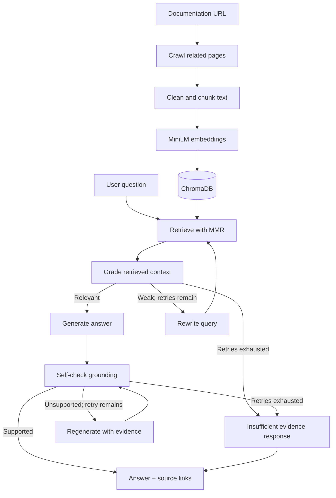

# DocuMind AI

**An agentic RAG assistant for exploring technical documentation.**

DocuMind AI turns public documentation pages into a searchable knowledge base. Users paste a documentation URL, select how many pages to crawl, and ask questions through a Streamlit interface. A LangGraph workflow retrieves evidence, evaluates it, rewrites weak queries when needed, generates grounded answers, and checks whether those answers are supported by the retrieved text.

> **Status:** Local project / portfolio demonstration. Not a hosted service or a security-hardened public crawler.

## Features

- **Multi-page ingestion:** Discover and extract related pages from a starting documentation URL.
- **Searchable knowledge base:** Chunk pages, embed them with `all-MiniLM-L6-v2`, and store the vectors in ChromaDB.
- **Diverse retrieval:** Use Maximum Marginal Relevance (MMR) to reduce redundant context.
- **Agentic workflow:** LangGraph orchestrates retrieval, relevance grading, query rewriting, generation, self-checking, and bounded retries.
- **Local LLM:** Generate and evaluate responses with Ollama and `gemma2:2b`.
- **Source references:** Show links to retrieved documentation pages under answers.
- **Streamlit interface:** Crawl controls, question-answer chat, session chat history, error messages, and agent execution details.

## Architecture



The crawler and indexing pipeline run during ingestion. The LangGraph workflow runs when a user asks a question. See [architecture notes](docs/ARCHITECTURE.md) for details.

## Technology stack

| Layer | Technology |
|---|---|
| Frontend | Streamlit, CSS |
| Orchestration | LangGraph |
| Retrieval | LangChain integrations, MMR |
| Embeddings | Sentence Transformers (`all-MiniLM-L6-v2`) |
| Vector database | ChromaDB |
| LLM | Ollama (`gemma2:2b`) |
| Crawling / parsing | Requests, Beautiful Soup |
| Language | Python |

## Run locally

**Prerequisites:** Python, Ollama installed and running, and internet access to load the embedding model and fetch documentation pages. The LLM itself runs locally.

```powershell
# In PowerShell, from the project folder
python -m venv venv
.\venv\Scripts\Activate.ps1
python -m pip install -r requirements.txt
ollama pull gemma2:2b
streamlit run app.py
```

If Ollama is not already running, start it separately using `ollama serve` (some Windows installations run Ollama automatically). On first use, the embedding model downloads from Hugging Face.

1. Open the local URL shown by Streamlit.
2. Paste a public documentation URL, for example `https://docs.python.org/3/tutorial/`.
3. Choose a page limit and select **Build my knowledge base**.
4. Ask a question about the indexed content.
5. Expand **References** and **Agent trace** to inspect the supporting pages and execution counters.

**Examples:** “How are Python functions defined?” or “What is the difference between lists and tuples?” The answer depends on which pages were actually crawled.

## Project structure

```text
app.py                    Streamlit interface
assets/styles.css         UI styling
.streamlit/config.toml    Streamlit theme
agent/
  state.py                Agent state schema
  nodes.py                Retrieval, grading, rewriting, generation, checking
  graph.py                Graph definition and routing
retrieval/
  chunking.py             Document splitting
  vector_store.py         Embeddings and ChromaDB access
  rag_chain.py            Baseline RAG flow (if retained)
ingestion/
  scraper.py              Single- or multi-page website scraping
scripts / test_*.py       Development test scripts (if retained)
docs/
  ARCHITECTURE.md         Architecture and decisions
  DEMO_CHECKLIST.md       Demo and validation steps
requirements.txt          Python packages
.gitignore                Excluded local/runtime files
```

## Agent behavior

The retrieval grader assesses whether retrieved chunks are useful. When evidence is weak, the graph can rewrite the query and retrieve again (currently up to **two rewrites**). After generation, another LLM-based check assesses whether the answer is grounded in the retrieved chunks; one regeneration attempt is allowed. If the workflow cannot obtain acceptable evidence, it returns a fallback instead of intentionally presenting an unsupported answer.

**Important:** Relevance grading and grounding verification are model judgments, not formal guarantees of correctness. Source links show retrieved pages, not audited claim-by-claim citations.

## Limitations and future work

- The basic requests/Beautiful Soup crawler may miss JavaScript-rendered content, dynamic navigation, and some non-HTML documents.
- Crawling is bounded but not ready to accept arbitrary untrusted URLs from the public internet; deployment would require robots.txt and crawl-policy handling, redirect/DNS protections, response-size limits, and stronger SSRF defenses.
- Chat history is stored in the Streamlit session for display; follow-up questions do not automatically include that history in the agent prompt.
- Persistent Chroma collections can accumulate on disk unless explicitly cleaned up.
- Retrieval and answer quality have not been benchmarked against a labeled evaluation set.

Possible extensions: PDF/Markdown upload, stronger HTML extraction, result reranking, retrieval evaluation, and hosted deployment with appropriate crawler safeguards.

## Testing

Run development checks from the project root after confirming Ollama is available:

```powershell
python test_retrieval.py
python test_end_to_end.py
```

These commands assume the corresponding test scripts are present. Use the [demo checklist](docs/DEMO_CHECKLIST.md) for a quick manual acceptance pass. The scripts check pipeline execution, not the truth of every answer.

## About

Built as a hands-on project to learn **LangGraph state, nodes, conditional edges, cycles, and agentic RAG**, while extending a traditional retrieval system with self-correction and evidence checks.

> Add a screenshot or short demo GIF here after capturing your running app. Do not publish secrets, local personal paths, or private documentation content.
